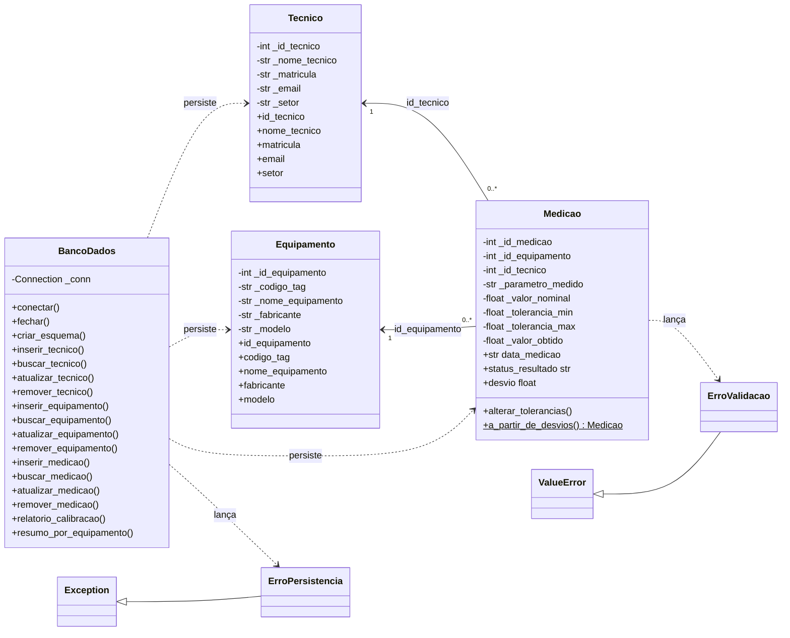

# Documentação Técnica do MVP (Parte 1)

**Unidade Curricular:** Projeto Aplicado I  
**Empresa Parceira:** Schulz S.A.  
**Entrega:** AV 03, Construção do MVP (Parte 1)  
**Professores:** Prof. MSc. Hugo Menezes Barra e Prof. Rodrigo Losina  
**Integrantes:** João Vítor Martins da Silva e Mario Nobre Porto  
**Data limite de entrega:** 03/11/2026  
**Linguagem escolhida:** Python 3 (biblioteca padrão `sqlite3`, sem dependências externas)

---

## 1. Visão Geral

Nas Entregas 01 e 02 mapeamos o processo manual de emissão de certificados de calibração, que hoje depende de planilhas Excel descentralizadas, e modelamos o banco relacional SQLite `schulz_calibracao.db`, com as tabelas `tecnico`, `equipamento` e `medicao`.

Nesta entrega o modelo conceitual virou código. O MVP Parte 1 reúne:

- as classes de domínio `Tecnico`, `Equipamento` e `Medicao`, com encapsulamento e validação;
- a regra metrológica que decide automaticamente entre `APROVADO` e `REPROVADO`;
- a classe de conexão e persistência `BancoDados`, que executa `INSERT`, `SELECT`, `UPDATE` e `DELETE` no SQLite;
- um script de demonstração que cria o banco, insere dados de teste, executa consultas com `JOIN` e imprime o relatório de calibração no terminal.

### 1.1. Estrutura de arquivos

| Arquivo | Papel |
| :--- | :--- |
| `04_classes.py` | Exceções, classes de domínio e camada de persistência |
| `05_main.py` | Script principal de demonstração (executável) |
| `06_mvp_parte1.md` | Este documento |

### 1.2. Como executar

```bash
python 05_main.py
```

Basta Python 3.9 ou superior. O script recria o arquivo `mvp_schulz_calibracao.db` a cada execução, então o resultado é sempre reproduzível. Como `04_classes.py` começa com um dígito, o `05_main.py` o carrega com `importlib.import_module("04_classes")`, já que um `import` comum não aceita esse nome.

### 1.3. Alinhamento com a Entrega 02

O enunciado cita as tabelas de forma genérica (`tecnicos`, `medicoes`). O código segue o DDL real da Entrega 02 (`03_banco.sql`): tabelas no singular e colunas `nome_tecnico`, `email`, `nome_equipamento`, `modelo`, `parametro_medido`, `tolerancia_min`, `tolerancia_max` e `status_resultado`. Assim, o banco criado pelo MVP é idêntico ao já entregue.

---

## 2. Arquitetura e Diagrama de Classes (UML textual)



Relações entre as classes:

- Um `Tecnico` pode ter várias `Medicao`, e cada `Medicao` pertence a um único `Tecnico` (chave `id_tecnico`).
- Um `Equipamento` também pode ter várias `Medicao`, e cada `Medicao` pertence a um único `Equipamento` (chave `id_equipamento`).
- `BancoDados` depende das três classes de domínio: grava seus dados e reconstrói objetos a partir das linhas lidas.

A `Medicao` guarda apenas os ids do técnico e do equipamento, como nas chaves estrangeiras do banco, em vez de carregar os objetos completos. Quando o relatório precisa dos nomes, a junção é feita no próprio banco, por `JOIN`.

---

## 3. Padrões de POO Utilizados (Python)

| Padrão ou princípio | Onde aparece | Motivo |
| :--- | :--- | :--- |
| Encapsulamento | Atributos privados (`_matricula`, `_valor_obtido`) expostos por `@property`, com setters que validam | Toda atribuição passa pela validação, então o objeto nunca fica em estado inválido |
| Atributo calculado | `Medicao.status_resultado` é uma `@property` sem setter | O status não pode ser digitado: sai sempre dos limites e do valor obtido. Isso resolve o risco, apontado na Entrega 02, de digitar por cima da fórmula na planilha |
| Imutabilidade parcial | Os `id_*` só aceitam uma atribuição, e os limites só mudam por `alterar_tolerancias()` | Protege a identidade do registro e garante que nominal e limites sejam validados juntos |
| Factory Method | `Medicao.a_partir_de_desvios()` (`@classmethod`) | Converte a notação de desenho (nominal 10,000 com desvios -0,020 e +0,030) nos limites absolutos gravados no banco |
| Separação de responsabilidades | Domínio (regras) e `BancoDados` (SQL) | O domínio não conhece SQL, e a persistência não conhece regras metrológicas |
| Gerenciador de contexto | `with BancoDados(...) as bd:` (`__enter__` e `__exit__`) | Fecha a conexão mesmo quando ocorre um erro |
| Transação por operação | `_transacao()` usa `with conn:` | Faz commit em caso de sucesso e rollback automático em caso de exceção |
| Hierarquia de exceções própria | `ErroValidacao` e `ErroPersistencia` | Quem chama distingue dado inválido de falha de banco |
| DRY | `_texto()` e `_numero()` | Uma só implementação de validação, usada pelas três entidades |

### 3.1. Regra de negócio metrológica

Definida no dicionário de dados da Entrega 02 e implementada em `Medicao.status_resultado`:

```
tolerancia_min = valor_nominal - |tolerância negativa|     (limite inferior)
tolerancia_max = valor_nominal + |tolerância positiva|     (limite superior)

APROVADO   se tolerancia_min <= valor_obtido <= tolerancia_max
REPROVADO  caso contrário
```

Alguns cuidados que o código toma:

- Os limites são inclusivos: uma leitura exatamente no limite é aprovada (caso 4 do relatório, com 10,030 e limite 10,030).
- A comparação usa uma margem `EPSILON = 1e-9`. Em ponto flutuante, `10.0 + 0.1` não é exatamente `10.1`, e sem a margem uma leitura de 10,1 seria reprovada por engano.
- Valores no padrão brasileiro, como `"10,030"` exportado de planilha, são aceitos e convertidos.
- O construtor rejeita `tolerancia_min` maior que `tolerancia_max` e também nominal fora da faixa.

### 3.2. Validações de domínio

| Classe | Campo | Regra |
| :--- | :--- | :--- |
| `Tecnico` | `nome_tecnico` | Texto de 3 a 120 caracteres, com espaços normalizados |
| `Tecnico` | `matricula` | 3 a 20 caracteres alfanuméricos, convertida para maiúsculas |
| `Tecnico` | `email` | Formato `x@y.z`, convertido para minúsculas |
| `Equipamento` | `codigo_tag` | Formato de tag (ex.: `703.1208`), em maiúsculas |
| `Equipamento` | demais campos | Texto obrigatório, não vazio |
| `Medicao` | chaves estrangeiras | Inteiros positivos |
| `Medicao` | valores numéricos | Números finitos (rejeita texto, `None`, `NaN`, `inf` e booleanos) |

---

## 4. Tratamento de Erros SQL

A validação acontece em duas camadas. O domínio rejeita o dado antes de chegar ao banco, e as restrições do SQLite (`UNIQUE`, `FOREIGN KEY`, `CHECK` e `NOT NULL`) funcionam como segunda barreira, caso algum caminho contorne as classes.

### 4.1. Mecanismos

1. Consultas parametrizadas. Todo valor entra por `?`, nunca por concatenação de texto, o que evita SQL Injection. Testamos com o filtro `x' OR '1'='1`, que devolve lista vazia.
2. Integridade referencial ativa. O SQLite ignora chaves estrangeiras por padrão, então `PRAGMA foreign_keys = ON` é executado em toda conexão (`conectar()`).
3. Transações. As escritas rodam em `with conn:`, e qualquer falha desfaz a operação inteira.
4. Tradução de exceções. `sqlite3.IntegrityError` e `sqlite3.Error` são capturadas em um único ponto (`_transacao()` e `_consultar()`) e relançadas como `ErroPersistencia`, com mensagem legível e a causa original preservada (`raise ... from e`).
5. Erros de uso. Operar com o banco desconectado, ou atualizar um objeto que ainda não tem `id`, gera um erro explícito.

### 4.2. Erros cobertos

| Situação | Quem bloqueia | Resultado |
| :--- | :--- | :--- |
| E-mail em formato inválido | Domínio | `ErroValidacao` |
| Valor obtido não numérico (`"abc"`) | Domínio | `ErroValidacao` |
| `tolerancia_min` maior que `tolerancia_max` | Domínio | `ErroValidacao` |
| Nominal fora da faixa de tolerância | Domínio | `ErroValidacao` |
| Filtro de status inválido no relatório | Domínio | `ErroValidacao` |
| Matrícula ou tag duplicada | SQLite (`UNIQUE`) | `ErroPersistencia` (registro duplicado) |
| Medição com equipamento ou técnico inexistente | SQLite (`FOREIGN KEY`) | `ErroPersistencia` (integridade referencial) |
| Excluir técnico ou equipamento que tem medições | SQLite (`ON DELETE RESTRICT`) | `ErroPersistencia` |
| Banco não conectado | Persistência | `ErroPersistencia` |

Todos os casos, exceto o último, são exercitados na seção 5 da saída do `05_main.py` (matrícula duplicada e tag duplicada são testadas separadamente, o que dá nove testes). O caso de banco não conectado foi conferido em teste à parte.

---

## 5. Validação do Fluxo Funcional do MVP

O `05_main.py` percorre o ciclo completo de uso, e cada etapa foi executada e conferida.

| Etapa | O que o script faz | Resultado verificado |
| :---: | :--- | :--- |
| 1 | Conecta e cria o esquema (`criar_esquema`) | Três tabelas criadas, idênticas ao `03_banco.sql` |
| 2 | Instancia 3 técnicos, 4 equipamentos e 7 medições | Objetos criados, e os ids gerados pelo banco voltam para os objetos |
| 3 | Persiste com `INSERT` | 14 registros gravados, com o status calculado pela regra da classe |
| 4 | `UPDATE`: corrige a planicidade de 0,035 para 0,015 | O status passa de `REPROVADO` para `APROVADO` e é confirmado relendo do banco |
| 5 | Provoca 9 erros propositais | Os 9 foram bloqueados e nenhum registro inválido foi gravado |
| 6.1 | Relatório com `INNER JOIN` (medição, equipamento e técnico) | 7 linhas com tag, parâmetro, limites, valor obtido, status e técnico |
| 6.2 e 6.3 | Filtros por `REPROVADO` e pela tag `703.1208` | Retornam só os registros esperados |
| 6.4 | `LEFT JOIN` com `GROUP BY` | Totais por equipamento, incluindo o `810.0042`, que ainda não tem medições |

### 5.1. Casos de teste da regra de status

| Nominal | Limites | Obtido | Esperado | Motivo |
| :---: | :---: | :---: | :---: | :--- |
| 25,000 | 24,950 a 25,030 | 25,012 | APROVADO | Dentro da faixa |
| 0,000 | 0,000 a 0,020 | 0,035 | REPROVADO | Acima do limite superior |
| 50,000 | 49,950 a 50,050 | 49,949 | REPROVADO | Abaixo do limite inferior |
| 10,000 | 9,980 a 10,030 | 10,030 | APROVADO | Exatamente no limite (inclusivo) |
| 10,000 | 9,950 a 10,100 | 10,100 | APROVADO | Limite calculado em ponto flutuante (`10.0 + 0.1`) |

### 5.2. Relatório de calibração (trecho da saída real)

```
 ID | TAG       | PARÂMETRO         |  NOMINAL |  LIM.MIN |  LIM.MAX |   OBTIDO | STATUS    | TÉCNICO
--------------------------------------------------------------------------------------------------------
  6 | 500.011   | Diâmetro Interno  |   40.000 |   39.995 |   40.005 |   40.002 | APROVADO  | Ana Beatriz Souza
  7 | 500.011   | Diâmetro Interno  |   40.000 |   39.995 |   40.005 |   40.011 | REPROVADO | Carlos Eduardo Pereira
  1 | 703.1208  | Diâmetro          |   25.000 |   24.950 |   25.030 |   25.012 | APROVADO  | Carlos Eduardo Pereira
  2 | 703.1208  | Planicidade       |    0.000 |    0.000 |    0.020 |    0.015 | APROVADO  | Carlos Eduardo Pereira
  3 | 703.1208  | Posição           |   50.000 |   49.950 |   50.050 |   49.949 | REPROVADO | Ana Beatriz Souza
```

---

## 6. Limitações e Próximos Passos (MVP Parte 2)

- Interface: o MVP roda pelo terminal e ainda não tem tela nem entrada interativa de dados.
- Importação: a leitura automática do relatório exportado pela máquina de medir por coordenadas (Calypso) ainda não existe. A validação já aceita vírgula decimal, o que facilita essa etapa.
- Certificado: gerar o certificado de calibração a partir do relatório é o objetivo final do projeto e fica para a Parte 2.
- Persistência: `BancoDados` concentra o CRUD das três entidades, o que serve para o tamanho do MVP. Se o sistema crescer, o passo natural é separar em um repositório por entidade (padrão DAO).
- Testes: a validação foi feita executando o roteiro e com testes de borda manuais. Testes automatizados com `unittest` ou `pytest` ficam como próximo passo.
- Dados de teste: todos os nomes, e-mails e valores do `05_main.py` são fictícios.
